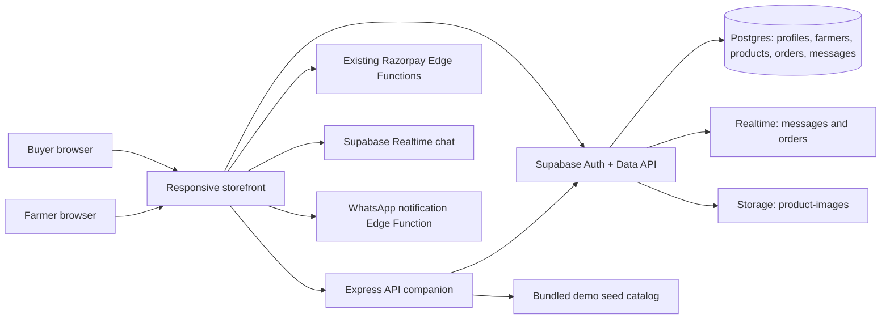
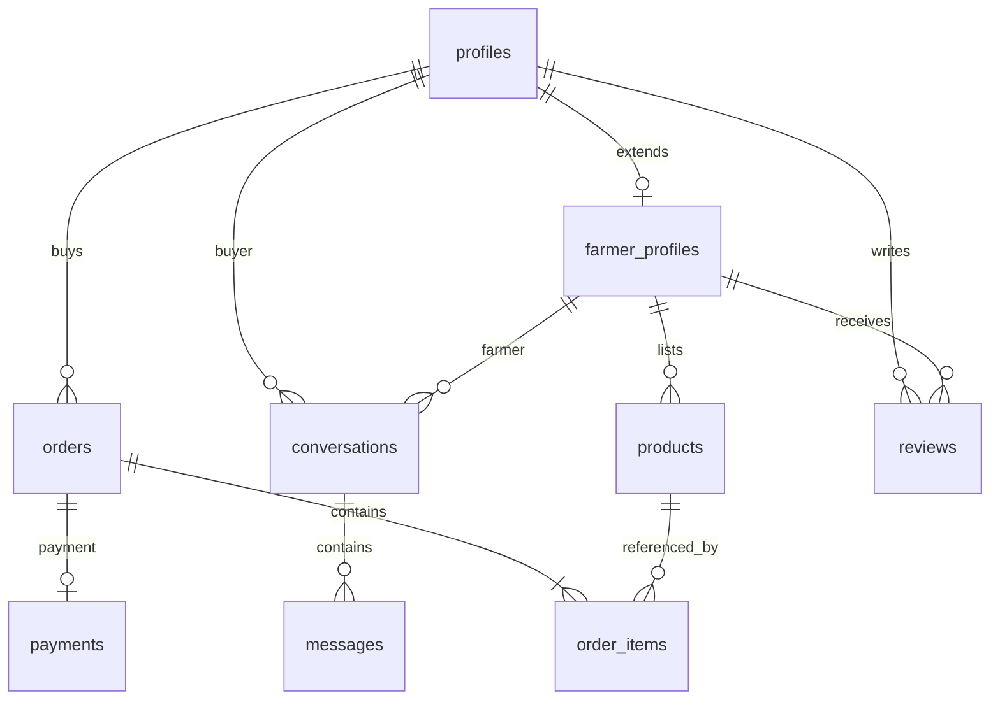

# RAITHUCONNECT architecture

## System shape

## Database entities

## Existing Supabase project
- Project ref: `czhwdzeheuvmocqpzmfq`
- Region: Mumbai (`ap-south-1`)
- Tables: `profiles`, `farmer_profiles`, `products`, `orders`, `order_items`, `reviews`, `conversations`, `messages`, `payments`
- Realtime: `messages` and `orders`
- Storage: `product-images` (public-read for product media; authenticated uploads are restricted to a folder named with the caller's UID)
- Demo catalog: `demo_products`, 15 illustrative records; RLS enabled and read-only for clients.

## Trust boundaries
- Browser only receives the Supabase publishable/anon key. Never put a service-role or Razorpay secret in frontend code.
- RLS remains the row-level authorization boundary.
- Payment status is verified server-side; webhook signature must be checked.
- WhatsApp alerts require a farmer phone number and explicit opt-in.
- Demo basket does not place a real order or take payment.

## Current architecture caveats
- The existing production site remains hosted by Wix. The local storefront prototype is separate until a safe feature-by-feature merge is performed.
- Railway and Notion connections were not available/accepted in this run.
- Razorpay and WhatsApp provider secrets must be configured in the Supabase Edge Functions secret manager before live notifications/payments can work.
